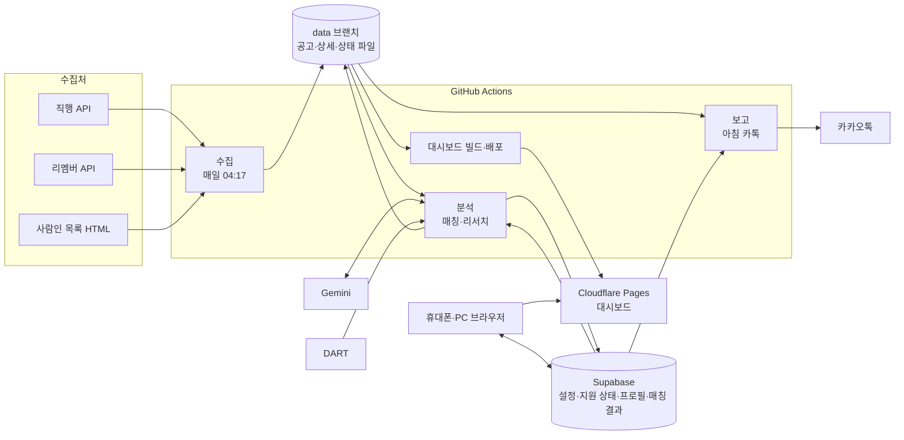

# 아키텍처

무엇이 어디서 돌고, 데이터가 어디로 흐르고, 어디에 저장되나.

> 초안(2026-10-13). 수집은 구현됐고, 대시보드·분석·보고는 아래 [열린 결정](#열린-결정)을 정한 뒤 구현한다.

## 구성도

## 부품

| 부품 | 하는 일 | 기술 | 비용·한도 | 상태 |
| --- | --- | --- | --- | --- |
| 수집 | 열린 공고를 매일 다시 훑고 바뀐 것만 저장 | Python, GitHub Actions | 하루 약 15분, 비공개 레포 무료 월 2,000분 | 구현됨 |
| 공고 저장소 | 공고 원본, 상세, 상태, 회사 구분 | `data` 브랜치 파일 | 무료 | 구현됨 |
| 분석 | 직무 분류, 매칭 점수, 회사 리서치 | Python, Gemini, DART | Gemini 무료 등급 한도 안에서 | 3·4단계 |
| 사람별 저장소 | 설정, 지원 상태, 프로필, 매칭 결과, 내 모듈 | Supabase(Postgres) | 무료 등급(저장 500MB, 1주 동안 접속이 없으면 일시 정지) | 결정 대기 |
| 대시보드 | 휴대폰·PC 반응형 화면 | 결정 대기 | Cloudflare Pages 무료 | 결정 대기 |
| 접근 제한 | 허용한 사람만 접속 | Cloudflare Access 또는 Supabase 로그인 | 무료(Access는 50명까지) | 결정 대기 |
| 보고 | 아침 카톡 요약 | 카카오 "나에게 보내기" | 무료, 토큰은 2개월마다 갱신 | 5단계 |

## 데이터

| 데이터 | 저장 위치 | 쓰는 쪽 | 읽는 쪽 | 개인정보 |
| --- | --- | --- | --- | --- |
| 공고 원본(처음 본 날별) | `data` 브랜치 `postings/YYYY/MM/DD.jsonl.gz` | 수집 | 분석, 대시보드 빌드 | 없음 |
| 공고 상세(본문) | `data` 브랜치 `details/YYYY/MM/DD.jsonl.gz` | 수집 | 분석 | 없음 |
| 공고 상태(처음·마지막 본 날, 마감, 중복, 해외, 잡음) | `data` 브랜치 `state.jsonl` | 수집 | 분석, 대시보드 빌드, 보고 | 없음 |
| 회사 구분 | `data` 브랜치 `companies.json` | 수집 | 분석, 대시보드 빌드 | 없음 |
| 실행 요약 | `data` 브랜치 `runs/YYYY-MM-DD.json` | 수집 | 사람(점검) | 없음 |
| 회사 리서치(모두에게 같은 것) | `data` 브랜치(예정) | 분석 | 대시보드 빌드 | 없음 |
| 설정, 지원 상태, 내 모듈 | Supabase | 대시보드 | 분석, 대시보드, 보고 | 있음 |
| 프로필·이력서 | Supabase | 대시보드 | 분석 | 있음 |
| 매칭 결과(사람별) | Supabase | 분석 | 대시보드, 보고 | 있음 |

원칙: 모두에게 같은 데이터(공고, 회사)는 `data` 브랜치 파일로, 사람마다 다른 데이터는 Supabase로 둔다. 개인정보는 레포에 올리지 않는다.

## 경계

- **수집 → 분석·대시보드**: `data` 브랜치의 파일. 형식은 `src/jobpost/store.py`와 `data` 브랜치 README에 있다. 수집은 이 형식만 지키면 다른 부품과 따로 바꿀 수 있다.
- **분석 → 대시보드**: 공용 결과는 `data` 브랜치 파일, 사람별 결과는 Supabase 테이블(예정).
- **대시보드 → Supabase**: 브라우저가 로그인한 본인 행만 읽고 쓴다(행 단위 권한, 예정).
- **외부 서비스**: Gemini, DART, 카카오는 각각 한 모듈에서만 부른다. 모델이나 서비스를 바꿀 때 그 모듈만 고친다.

## 실행 일정

| 시각(KST) | 작업 | 걸리는 시간 | 상태 |
| --- | --- | --- | --- |
| 04:17 | 수집 | 약 15분 | 구현됨 |
| 수집 뒤 | 분석(매칭, 리서치) | 미정 | 3·4단계 |
| 분석 뒤 | 대시보드 빌드·배포 | 미정 | 2단계 |
| 아침(시각 미정) | 카톡 보고 | 1분 안쪽 | 5단계 |

## 보안과 권한

- 키와 토큰(Gemini, DART, 카카오, Supabase 서버 키, Cloudflare 배포 토큰)은 GitHub Secrets에만 둔다. 코드, 커밋, 로그에 남기지 않는다.
- 브라우저에는 Supabase 공개 키만 둔다. 데이터 보호는 로그인과 행 단위 권한으로 한다.
- 이력서 원문과 프로필은 Supabase에만 저장한다.

## 열린 결정

대시보드를 만들기 전에 정한다. 고른 결과는 [결정 기록](decisions.md)에 남긴다.

### 1. 대시보드가 공고를 읽는 방식

| 선택지 | 방식 | 좋은 점 | 아쉬운 점 |
| --- | --- | --- | --- |
| **A. 정적 파일 (추천)** | 매일 수집 뒤 `data` 브랜치에서 화면용 파일을 만들어 대시보드와 함께 배포 | 무료, 단순, 빠름. 서버가 없다 | 검색·필터는 브라우저에서 한다(국내 열린 공고 약 7천 건이라 충분). 파일 수 제한(배포당 2만 개)을 넘지 않게 묶어서 만든다 |
| B. Supabase에 공고 적재 | 수집 뒤 공고를 Supabase 테이블에 넣고 대시보드가 조회 | 서버에서 검색·필터, 사람별 데이터와 합치기 쉽다 | 적재 작업과 관리할 것이 늘고, 무료 저장 한도(500MB)를 공고가 차지한다 |

### 2. 사람별 데이터를 두는 곳

| 선택지 | 방식 | 좋은 점 | 아쉬운 점 |
| --- | --- | --- | --- |
| **A. 전부 Supabase (추천)** | 설정, 지원 상태, 프로필, 매칭 결과, 내 모듈을 사람별 행으로. 행 단위 권한으로 본인 것만 | 지인이 써도 데이터가 섞이지 않는다. 대시보드에서 바로 저장된다 | Supabase 사용법을 익혀야 한다 |
| B. 매칭 결과만 파일, 나머지 Supabase | 매칭 결과를 사람별 파일로 배포 | Supabase 사용량이 적다 | 파일은 사람별로 접근을 막기 어렵다 |

### 3. 화면 기술

| 선택지 | 좋은 점 | 아쉬운 점 |
| --- | --- | --- |
| **A. React + Vite + TypeScript (추천)** | 필터, 토글, 지원 상태처럼 화면 상태가 많아도 다루기 쉽다. 자료와 도구가 가장 많아 개발 세션이 안정적으로 다룬다. 정적 빌드로 Pages에 그대로 올린다 | 번들이 조금 크다 |
| B. SvelteKit(정적) | 가볍고 빠르다 | 자료가 상대적으로 적다 |
| C. Astro | 정적 페이지 중심이라 아주 가볍다 | 상호작용이 많은 화면에는 손이 더 간다 |

색·글꼴은 CSS 변수(디자인 토큰)로 두고, 디자인 스타일을 정한 뒤 채운다.

### 4. 로그인

| 선택지 | 방식 | 좋은 점 | 아쉬운 점 |
| --- | --- | --- | --- |
| **A. Cloudflare Access + Supabase 로그인 (추천)** | 사이트 전체는 허용한 이메일만 열리고, 개인 데이터는 Supabase 로그인과 행 단위 권한으로 보호 | 공고·리서치까지 외부에 안 보인다. 기획 때 정한 방식과 같다 | 처음에 로그인을 두 번 한다(둘 다 한동안 유지됨) |
| B. Supabase 로그인만 | 이메일 링크로 한 번 로그인 | 단순하다 | 공고·리서치 화면 주소를 알면 누구나 볼 수 있다(개인정보는 없음) |
