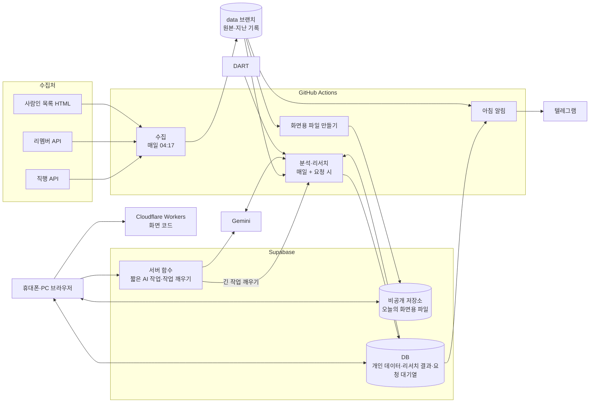

# 아키텍처

무엇이 어디서 돌고, 데이터가 어디로 흐르고, 어디에 저장되나.

> 2026-10-13 확정. 수집은 구현됐고, 나머지는 단계마다 이 구조대로 만든다. 지인이 다른 직무로 쓰는 경우는 실제로 써 본 뒤 다시 본다.

## 구성도

## 부품

| 부품 | 하는 일 | 기술 | 비용·한도 | 상태 |
| --- | --- | --- | --- | --- |
| 수집 | 열린 공고를 매일 다시 훑고 바뀐 것만 저장 | Python, GitHub Actions | 하루 약 15분. 비공개 레포 무료 월 2,000분 | 구현됨 |
| 원본 보관함 | 공고 원본, 상세, 상태, 회사 구분, 지난 기록 | `data` 브랜치 파일 | 무료 | 구현됨 |
| 화면용 파일 | 매일 수집 뒤 오늘 열린 국내 공고와 회사 기본정보를 파일 하나로 묶음(압축 약 400KB). 본문은 공고 id로 나눈 16개 파일(묶음당 약 100~250KB)에 따로 담고, 상세를 열 때 그 공고가 든 묶음만 받는다 | Python, GitHub Actions | 매일 덮어씀 | 구현됨 |
| 비공개 저장소 | 화면용 파일을 로그인한 사람에게만 내줌 | Supabase Storage | 무료 1GB | 운영 중 |
| DB | 개인 데이터, 리서치 결과, 요청 대기열 | Supabase(Postgres), 행 단위 권한 | 무료 500MB. 1주 동안 접속이 없으면 일시 정지(매일 작업이 접속하므로 괜찮음) | 2단계부터 |
| 로그인 | 허용한 사람만, 구글 계정으로(이메일 링크는 예비). 기기마다 한 번 | Supabase Auth + Google | 무료 | 운영 중(가입 막음, 초대한 사람만) |
| 화면 | 휴대폰·PC 반응형 대시보드 | React + Vite + TypeScript, Cloudflare Workers 정적 사이트(화면 코드만) | 무료 | 첫 버전(리포트·공고·회사) 운영 중 |
| 서버 함수 | 짧은 AI 작업(몇 초)을 바로 처리, 긴 작업이 들어오면 GitHub Actions를 깨움 | Supabase Edge Functions | 무료 등급 | 3·4단계 |
| 분석·리서치 | 직무 분류, 매칭, 커리어 지표, 회사 리서치(매일 정기 + 요청 시) | Python, GitHub Actions, Gemini, DART | Actions 시간과 Gemini 무료 한도 안에서 | 직무 분류·매칭·커리어 지표(화면용 파일 만들 때 계산, 약 20초)·회사 기본정보(DART) 구현됨, 심층분석은 나중 |
| 아침 보고 | 아침 알림(새 공고 요약) | 텔레그램 봇 리치 메시지(기본, 실패하면 일반 메시지), 카카오 "나에게 보내기"(꺼 둠), Python, GitHub Actions | 무료. 리치 메시지 한 통 32768자, 일반 메시지 4096자. 카톡은 연결 토큰 60일, 1개월 미만 남으면 매일 작업이 새 토큰으로 바꿔 저장 | 초안 운영 중(텔레그램 연결 뒤) |

## 데이터

원칙: **하루 한 번 바뀌고 모두가 읽기만 하는 것은 파일**, **수시로 생기고 사람이나 직무 분야마다 다른 것은 DB**. 개인정보는 레포에 올리지 않는다.

| 데이터 | 저장 위치 | 쓰는 쪽 | 읽는 쪽 | 누구 기준 |
| --- | --- | --- | --- | --- |
| 공고 원본·상세·상태·회사 구분·실행 요약 | `data` 브랜치 | 수집 | 분석, 화면용 파일 만들기, 보고 | 모두 같음 |
| 공고 정리(공고마다 AI가 뽑은 매칭 항목, `facts.jsonl`) | `data` 브랜치 | 공고 정리 | 매칭, 화면용 파일(스킬 목록) | 모두 같음 |
| 회사 기본정보(DART 잇기 결과 `dart/corps.json`, 받은 기본정보 `dart/basics.json`, 상장사 목록 `dart/listed.json`: 고유번호 파일에서 종목코드가 있는 회사, 사업보고서를 낸 비상장 회사 `dart/filers.json`, 둘 다 7일마다) | `data` 브랜치 | 회사 기본정보(dart) | 회사 기본정보 파일 | 모두 같음 |
| 회사 기본정보 파일(회사마다 DART 기본정보 + 지난 공고, `companies.json.gz`) | Supabase 저장소 | 화면용 파일 만들기 | 브라우저(회사 화면을 열 때 한 번) | 모두 같음 |
| 화면용 파일(오늘 열린 공고, 회사 기본정보, 커리어 지표: 직무 유형 × 기업 구분별 날짜별 열린·새 공고 수, 지금 열린 공고의 경력 요구·요구 스킬, 수집 현황, 아침 알림 기본값) | Supabase 저장소 | 화면용 파일 만들기 | 브라우저 | 모두 같음 |
| 심층 리서치: 사업 구조, 경쟁사, 업계 기초, 현직자 리뷰 | DB | 분석·리서치 | 브라우저 | 모두 같음(회사당 1개) |
| 심층 리서치: 직무 분야 전략, 직무 조직, 직무 환경·도구 | DB | 분석·리서치 | 브라우저 | 직무 분야가 같은 사람끼리(회사 × 직무 분야당 1개) |
| 내 모듈 정의와 결과 | DB | 서버 함수, 분석·리서치 | 브라우저 | 본인만 |
| 설정(필터 `settings.filters`, 아침 알림 받기 `settings.notify`), 관심 회사 | DB | 브라우저 | 브라우저, 분석, 보고 | 본인만 |
| 지원 상태(단계·메모·날짜, 공고가 내려가도 보이게 회사·제목·주소·마감 사본) | DB `applications` | 브라우저 | 브라우저, 아침 알림 | 본인만 |
| 할 일(커리어 탭 이번 달 할 일: 달, 내용, 종류, 스킬, 끝냄) | DB `plans` | 브라우저 | 브라우저(월간 커리어 리포트를 만들면 분석도) | 본인만 |
| 관심 회사(★: 회사 키) | DB `company_stars` | 브라우저 | 브라우저(심층분석 AI 모듈을 만들면 분석도) | 본인만 |
| 내 리서치 노트(회사마다 정해진 블록 JSON) | DB `research_notes`(쓰기는 서버 키만). 원본은 `data` 브랜치 `notes/<회사 키>.json` | 노트 넣기(`jobpost notes`, 매일 수집 · notes.yml) | 브라우저(회사 화면, 노트 화면) | 본인만 |
| 프로필·이력서 | DB | 브라우저 | 분석 | 본인만 |
| 매칭 결과(점수, 판단 근거) | DB `matches` | 분석 | 브라우저, 보고 | 본인만 |
| 내 평가(○△× + 코멘트, 그때의 판단 근거) | DB `feedback` | 브라우저 | 회차 리포트 | 본인만 |
| 알림 받을 텔레그램 대화방, 마지막으로 보낸 날 | DB `telegram_links`(쓰기는 서버 키만. 화면은 본인 줄의 연결 여부·마지막으로 보낸 날만 읽고 대화방 id는 못 읽음) | 알림 연결(telegram.yml), 아침 알림 | 아침 알림, 관리 화면 | 본인만 |
| 카톡 연결 토큰, 마지막으로 보낸 날 | DB `kakao_links`(서버 키만, 화면 권한 없음) | 카톡 연결(kakao.yml), 아침 알림 | 아침 알림(카톡을 켰을 때) | 본인만 |
| 각자의 AI 키 | DB 암호화 보관(Supabase Vault) | 브라우저(저장할 때만) | 서버 함수, 분석 | 본인만, 저장 뒤 화면에 다시 보이지 않음 |
| 요청 대기열 | DB | 브라우저 | 서버 함수, 분석 | 본인만 |

- 리서치를 함께 쓰므로 같은 회사를 두 번 조사하지 않는다. 비용은 처음 요청한 사람의 AI 키로 낸다. 누가 요청했는지, 누가 관심 회사로 찍었는지는 공유하지 않는다.
- 브라우저에서는 공용 화면용 파일과 리서치 위에 본인 데이터(관심, 매칭 점수, 메모)를 얹어서 보여준다.
- 필터·검색·정렬은 브라우저가 화면용 파일을 한 번 받아서 직접 한다(국내 열린 공고 약 7천 건).

## 분류 기준

함께 쓰거나 날짜별로 비교하는 기준만 고정한다.

| 기준 | 정하는 방식 | 관리 |
| --- | --- | --- |
| 직무 분야(넓게, 리서치를 함께 쓰는 단위) | 고정 목록에서 선택. 처음 목록은 리멤버 대분류를 줄여 12~15개, 지금은 AI·데이터만 켬 | 관리자 |
| 직무 유형(좁게, 공고 분류·매칭·커리어 지표) | 고정, 버전 관리(`config/job_types.yaml`). AI가 공고마다 하나를 고르고 결과는 `state.jsonl`의 `job_type`에 버전·모델과 함께 남긴다 | 관리자 |
| 수집 범위(분류·키워드) | `config/collect.yaml` | 관리자. 직무 분야를 켤 때 그 분야 수집 범위도 함께 넓힌다 |
| 개인 필터, 내 모듈 주제 | 자유 입력 | 각자 |

## 경계

- **수집 → 나머지**: `data` 브랜치 파일. 형식은 `src/jobpost/store.py`와 `data` 브랜치 README. 수집은 이 형식만 지키면 따로 바꿀 수 있다.
- **화면용 파일**: 매일 수집 뒤 하나를 만들어 Supabase 저장소 `screen/screen.json.gz`와 `screen/bodies/00~0f.json.gz`, 회사 기본정보 `screen/companies.json.gz`에 덮어쓴다. 본문 묶음 번호는 공고 id의 FNV-1a 해시로 정하고 Python(`screen.body_shard`)과 화면(`load.ts bodyShard`)이 같아야 한다. 형식은 만드는 쪽 `src/jobpost/screen.py`와 읽는 쪽 `web/src/lib/types.ts`가 같아야 하고, 바꾸면 `version`을 올린다. 마감 D-숫자는 보는 날에 따라 바뀌어서 브라우저가 계산한다.
- **브라우저 ↔ DB**: 로그인한 본인 행만 읽고 쓴다(행 단위 권한). 공용 리서치는 로그인한 사람 모두 읽기만 한다.
- **긴 작업**: 브라우저가 요청 대기열에 한 줄 넣으면 서버 함수가 GitHub Actions를 깨우고, Actions가 처리해 결과를 DB에 쓴다. 화면은 "조사 중 → 완료"를 보여준다.
- **외부 서비스**: Gemini, DART, 텔레그램, 카카오는 각각 한 모듈에서만 부른다. 모델이나 서비스를 바꿀 때 그 모듈만 고친다.

## 실행

| 언제 | 작업 | 걸리는 시간 | 상태 |
| --- | --- | --- | --- |
| 매일 04:17 KST | 수집 | 약 15분 | 구현됨 |
| 수집 안 | 직무 유형 분류(새 공고, 80건씩 묶어 AI 호출) | 하루 몇 분 | 구현됨 |
| 수집 뒤 | 공고 정리: 사람마다 필터를 통과한 공고(후보)의 합집합에서 아직 안 한 것을 공고당 1번 AI로. 하루 한도까지 | 하루 몇~20분 | 구현됨 |
| 수집 뒤 | 화면용 파일 만들기·올리기(스킬 목록, 프로필 선택지 포함) | 1분 안쪽 | 구현됨 |
| 수집 뒤 | 매칭: 후보 공고를 AI가 하나씩 매기고 판단 근거를 남김(점수는 코드가 가중치×판정으로 계산). 규칙 점수도 비교용으로 함께. Supabase `matches`에 사람마다 통째로 다시 씀. 같은 공고·프로필 버전·지침 버전·모델이면 지난 결과를 다시 씀 | 새 공고만이면 몇 분, 다시 매기는 날 약 25분 | 구현됨. 다시 하려면 Actions > match(scope=sample이면 기준 샘플 60건만, 약 5분) |
| 내가 원할 때 | 회차 리포트: 기준 샘플에서 지금 점수를 내 평가와 비교한 지표, 어긋난 공고와 판단 근거(로그) | 1분 안쪽 | 구현됨. Actions > feedback |
| 수집 뒤(공고 정리 다음) | 회사 기본정보: 오늘 공고 회사를 DART와 잇고, 아직 없거나 30일 지난 회사의 기업개황·주요 계정·직원 현황·주요 공시를 받음. 요청 800건까지 | 몇 분 | 구현됨. 처음 한꺼번에는 Actions > dart |
| 화면용 파일 뒤 | 내 리서치 노트 넣기: `data` 브랜치 `notes/*.json`을 확인하고(블록 · 출처) 사람마다 `research_notes`에 씀. 누구 노트인지는 파일의 user_id, 없으면 프로필이 하나일 때 그 사람 | 1분 안쪽 | 구현됨. 바로 넣으려면 Actions > notes |
| 수집 뒤 | 정기 분석·리서치(심층분석 모듈, 새 뉴스) | 미정 | 나중 |
| 매칭 뒤(collect 마지막 단계) | 아침 알림: 연결한 사람마다 켜 둔 채널(`config/notify.yaml`)로 새 공고 요약을 보냄. 같은 날 두 번 보내지 않음 | 1분 안쪽 | 초안 구현됨. GitHub 예약 실행이 3시간가량 늦게 시작하는 날이 있어(10/15·16은 07:20경) 도착은 8시 전후 |
| 내가 원할 때 | 알림 연결 또는 오늘 알림 다시 보내기 | 1분 안쪽 | Actions > telegram(카톡은 kakao) |
| 버튼을 누를 때 | 짧은 AI 작업(내 모듈 정의, 수정 요청) | 몇 초 | 3·4단계 |
| 버튼을 누를 때 | 긴 AI 작업(조사, 다시 조사, 다시 매칭) | 1~5분 | 3·4단계 |

- 사람별 하루 요청 수에 상한을 둔다(예: 조사 하루 10건). 무료 AI 한도와 Actions 시간을 지키기 위해서다.
- Actions 시간이 모자라면 긴 작업만 다른 실행 환경으로 옮긴다. 나머지 구조는 그대로 둔다.

## 보안과 권한

- 운영 키와 토큰(DART, 텔레그램 봇, 카카오 앱, Supabase 서버 키, GitHub 토큰, 기본 Gemini 키)은 GitHub Secrets와 서버 함수 비밀값에만 둔다. 코드, 커밋, 로그에 남기지 않는다.
- 브라우저에는 Supabase 공개 키만 둔다. 데이터 보호는 로그인과 행 단위 권한으로 한다.
- 화면 코드(Cloudflare)에는 데이터를 넣지 않는다. 공고와 리서치는 로그인해야 받을 수 있다. 수집처 내용을 공개 사이트에 다시 올리지 않기 위해서다.
- 각자의 AI 키는 암호화해 보관하고 서버 쪽에서만 꺼내 쓴다.

## 다시 볼 것

- 지인이 다른 직무로 쓸 때: 직무 분야 목록, 분야별 수집 범위, 함께 쓰기 방식을 실제로 써 보고 조정한다.
- 요청이 늘어 Actions 시간이 모자랄 때: 긴 작업 실행 환경.
- 화면용 파일이 커질 때(열린 공고가 수만 건): 파일을 나누거나 DB 조회로 바꾼다.
